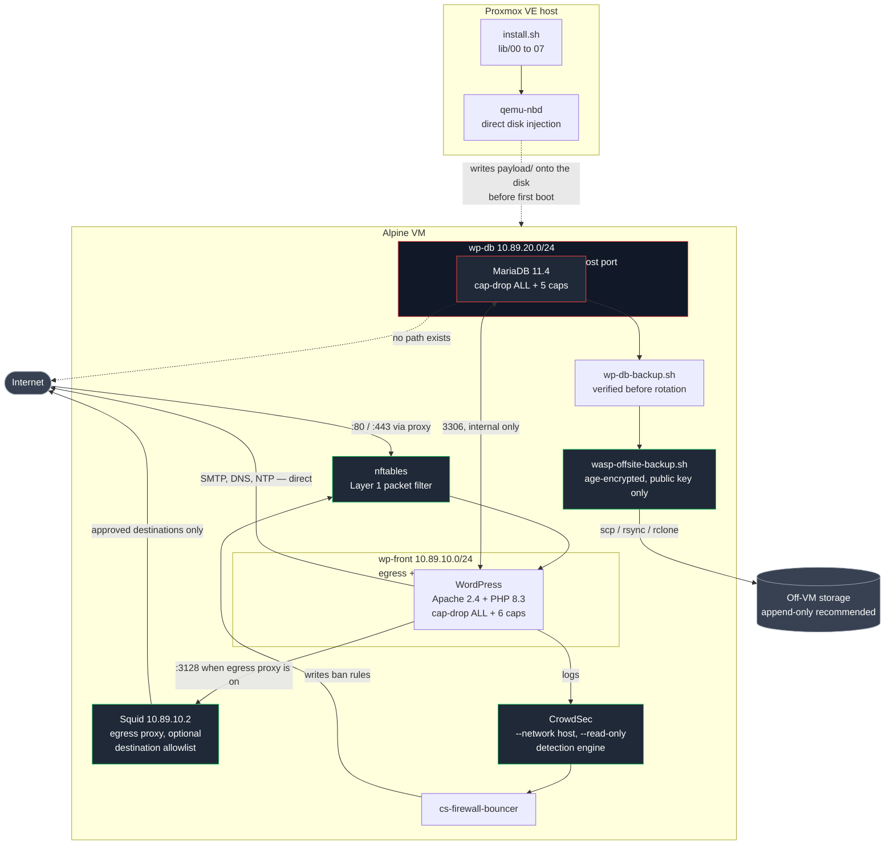
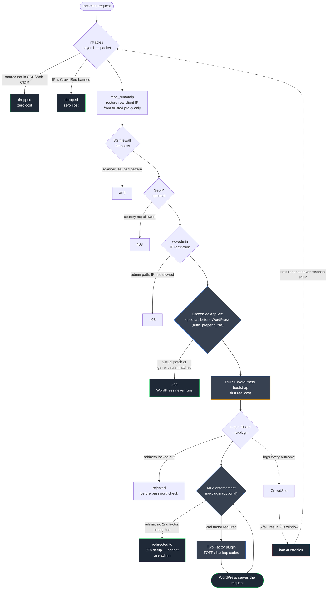
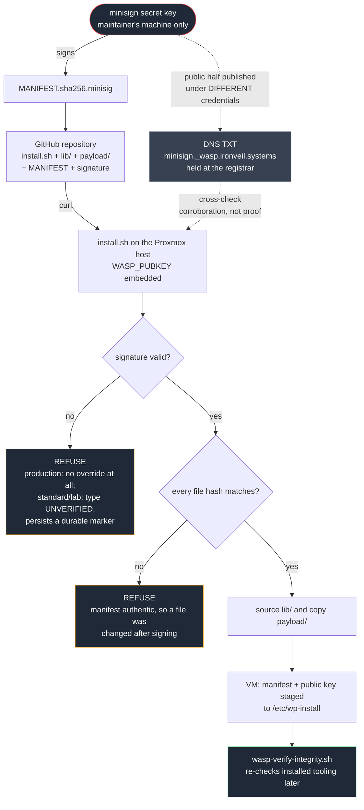
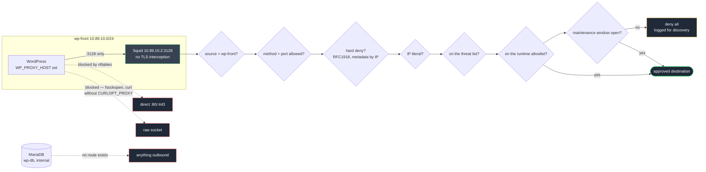
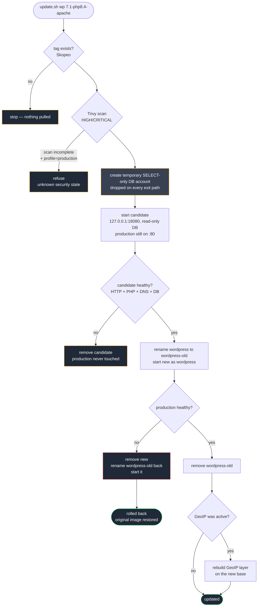
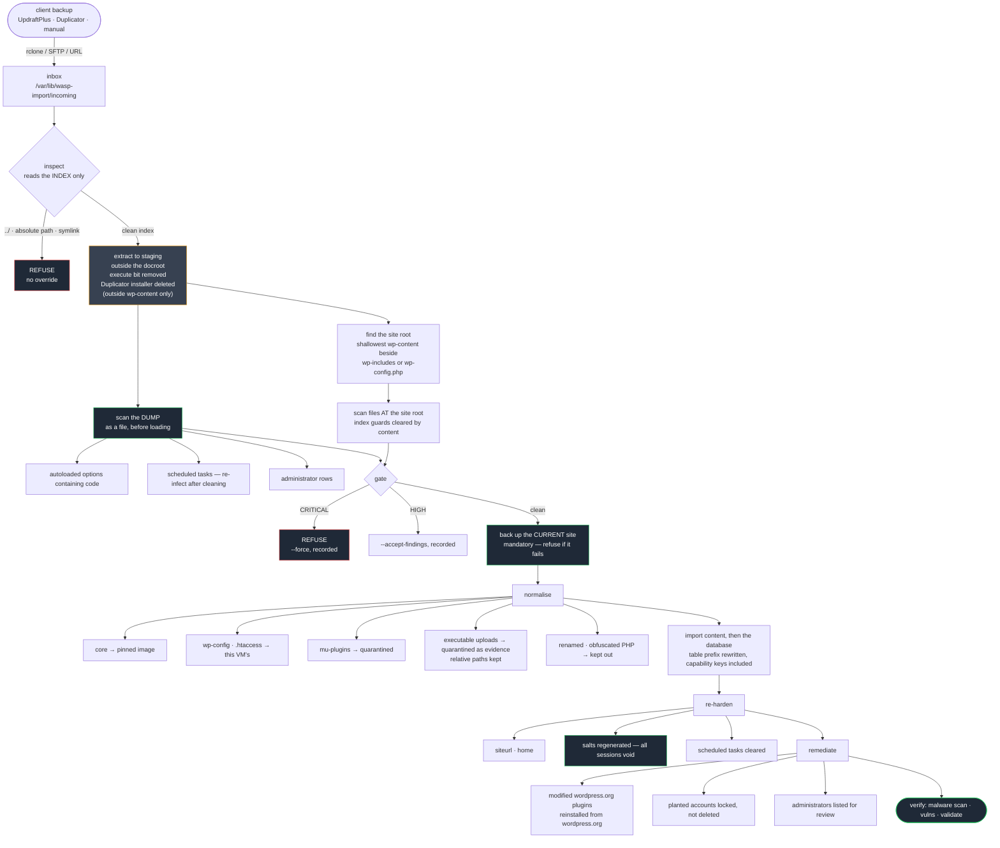
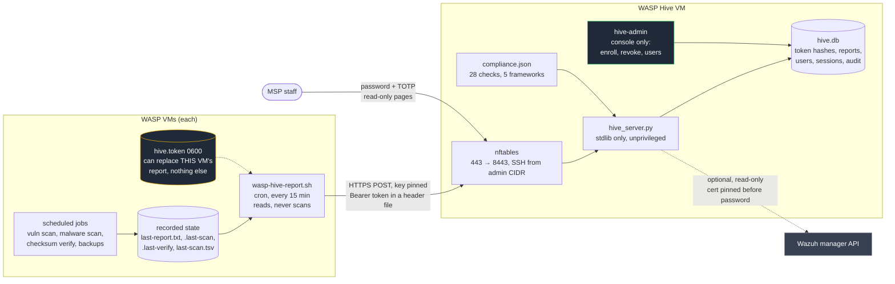

# WASP — Architecture

Diagrams render natively on GitHub. Eight views, because one diagram covering all of this would be unreadable:
what exists, what a request passes through, where trust comes from, what may
leave, how it gets built, how it changes safely, how another site's content gets
in, and what maintains it afterwards. A ninth section walks the login path in
prose, since that one is a sequence of decisions rather than a shape.

---

## 1. Components and trust boundaries

The important structural fact is that **MariaDB has no route to the
internet and no host port**. It sits on a Podman `--internal` network, so a
compromised WordPress cannot reach past it and the database is not exposed
even if a firewall rule is wrong.



---

## 2. What a request passes through

Each layer is cheaper than the one after it. A packet dropped at nftables
costs nothing; a request that reaches PHP has already cost a WordPress
bootstrap and a database query. That ordering is the whole point — it is why
brute-force protection escalates from the application layer down to the
firewall rather than living only in PHP.



---

## 3. Release trust chain

The evaluation that prompted this section put it well: signing was implemented
but not *represented*, so a reader could not see where trust starts or where it
stops. It stops in a specific place, and the diagram says so.



**Where trust actually starts.** A first-time user fetching `install.sh` and
the release from the same repository is trusting that repository — an attacker
who could swap the tarball could swap the embedded key too. Signing does not
change that. What it changes is that the swap becomes **detectable**: the key
would have to change, and the DNS record is held under separate credentials.

**Where it stops.** The DNS cross-check is spoofable without DNSSEC.
`wasp-verify-integrity.sh` runs on the VM, so an attacker with root there can
edit it. Neither is a root of trust; both make tampering evident.

---

## 4. Egress boundary

The ingress side of this system is deliberately public. The egress side is
not. Two independent controls, and the second is the one that makes the first
mean anything.



**Why the order is not cosmetic.** Every deny precedes every allow. A hard
deny placed after the allowlist could be overridden by a wildcard entry —
which is how a cloud metadata endpoint becomes reachable because somebody
allowlisted too broadly. Metadata is denied by **address**, not only by name,
because the property has to survive a request made straight to
`169.254.169.254`, which is exactly what an SSRF payload does.

**Why HTTPS can be filtered without decrypting it.** A client opening an
HTTPS connection through a proxy sends `CONNECT host:443` in plaintext before
the TLS handshake. `dstdomain` matches on that. No SSL Bump, no certificate
authority on the VM, and no ability to read the traffic — only to see where it
is going.

**Why the firewall half is load-bearing.** `WP_PROXY_HOST` is honoured only by
code that chooses to honour it. A plugin calling `fsockopen()`, or `curl`
without `CURLOPT_PROXY`, ignores it entirely. Without the nftables rule the
proxy filters well-behaved traffic only — which is not the traffic anyone is
worried about. `wasp-egress test` proves this by removing WordPress's proxy
configuration and confirming egress *still* fails.

**What it does not do.** This limits *where* traffic goes, not what it
carries. An approved destination that is itself compromised remains reachable.

---

## 5. Install flow

Two phases, split by a reboot: the kernel switch has to happen before
containers exist.

```mermaid
flowchart LR
    subgraph P0["Proxmox host"]
        A["install.sh"] --> B["prompts<br/>lib/01"]
        B --> C["fetch Alpine<br/>verify SHA-512"]
        C --> D["build nftables +<br/>Apache config<br/>lib/03"]
        D --> E["mount disk<br/>qemu-nbd"]
        E --> F["inject payload/<br/>+ vars.sh"]
        F --> G["qm create + start"]
    end

    G --> H

    subgraph P1["VM — stage 1"]
        H["expand rootfs<br/>apk upgrade"] --> I["switch to linux-lts"]
        I --> J(["reboot"])
    end

    J --> K

    subgraph P2["VM — stage 2 : stages 01-10"]
        K["health checks<br/>kernel + Podman"] --> L["digest-pin images<br/>Skopeo"]
        L --> M["networks + secrets"]
        M --> N["Apache hardening<br/>8G, slug, CSP"]
        N --> O["MariaDB then WordPress<br/>then GeoIP"]
        O --> P["OpenRC services"]
        P --> Q["update + mail +<br/>plugin tooling"]
        Q --> R["CrowdSec + backups"]
        R --> S["Trivy, Lynis,<br/>malware scanner"]
        S --> T(["validate: ~45 checks"])
    end

    style J fill:#374151,stroke:#f59e0b,color:#fff
    style T fill:#1f2937,stroke:#22c55e,color:#fff
    style MENU fill:#374151,stroke:#3b82f6,color:#fff
```



---

## 6. Update: candidate, cutover, rollback

Production keeps serving throughout the risky part. The old container is not
destroyed until the new one has proven itself — it *is* the rollback artifact.



### 6.1 A replacement container must inherit the deployment's shape

The cutover above replaces a container by name. Everything that made the
original container what it is — its environment, its topology — has to be
reproduced, and anything the update hardcodes instead is a bug that only
appears on deployments shaped differently from the author's.

CrowdSec is the live example. It runs in one of two topologies:

- **local LAPI** — the engine and its API both on this VM
- **agent-only** — the agent reports to a LAPI on another host, created with
  `-e DISABLE_LOCAL_API=true -e LOCAL_API_URL=http://<host>:8080/`

`update.sh` hardcoded the first. On an agent-only install the replacement
came up as a full local API node, re-registered itself against `127.0.0.1`,
and the health check waited for a LAPI that was never going to answer. The
update could not succeed at any timeout — while reporting `LAPI not
responding`, which reads as *the remote LAPI is down* rather than *this
container was built wrong*.

`do_cs_update` now reads `DISABLE_LOCAL_API`, `LOCAL_API_URL` and
`DISABLE_AGENT` off the running container and carries them forward, and the
suite enumerates every such variable the installer can set, failing if one is
not inherited. The general rule: **read the shape off what is running, do not
assume it.**

Two related properties of this path, both learned the same way:

**The health-check wait must allow for first-start work.** A version change
migrates config and the local database before the API answers. Thirty seconds
was not enough, so the update rolled back on containers that were merely
starting. It is three minutes now, and it gives up early if the container has
actually exited.

**The rollback must not destroy the evidence.** It removed the failed
container immediately, taking with it the only record of why. The logs,
`cscli lapi status` and the exit code are now written to
`/var/log/wasp-crowdsec-upgrade-failed.log` before the container goes.

### 6.2 Trivy stages through the cache directory, not `/tmp`

`--cache-dir` governs where the vulnerability database is **kept**; `TMPDIR`
governs where it is **staged** during download. On Alpine `/tmp` is a tmpfs
sized from RAM — commonly 256 MB — against gigabytes free on the real disk.
The database does not fit, every download fails, and the error names the
*vulnerability database* rather than the disk.

Because the production profile correctly refuses to update on an incomplete
scan, this silently blocks **every** security update on the VM. `update.sh`
therefore points `TMPDIR` at `${TRIVY_CACHE_DIR}/tmp`, which is on real disk
by definition, and says so explicitly if it cannot.

---

## 7. Site import

The ordering *is* the security property. Every stage exists to keep untrusted
content away from anything that executes it until it has been examined.



### 7.1 Nested archives, and why the depth limits were a security bug

A cPanel/WHM full-account backup does not look like a site archive. The
WordPress install sits at `<account>/public_html/`, surrounded by `.trash/`,
`.conf/`, mail and the panel's own state — and `wp-content` itself contains
`updraft/`, `plugins-old/` and `upgrade-temp-backup/`, each with their own
nested `wp-content`.

Site-root detection searched to `maxdepth 2`; the real `wp-content` was at
depth 3. Dump collection searched to `maxdepth 3`; the UpdraftPlus `-db.gz`
was at depth 5. Both missed, on an archive shape that is extremely common.

That is not a cosmetic limitation. **An operator who cannot use the pipeline
works around it** — extracting and copying by hand, which bypasses the scan
gate that stands between a staged tree and the docroot. On a real import that
detour carried a webshell into a live site. The depth limits did not fail to
find a file; they routed a compromised tree around the control designed to
catch it.

Detection now searches deeper and chooses by two rules, because a backup
archive is full of decoys:

1. A site root has `wp-content` **and** `wp-includes` or `wp-config.php`
   beside it. A backup folder inside `wp-content` has neither.
2. Prefer the **shallowest** match — the real site is always closer to the
   archive root than a backup buried inside it.

Multiple dumps are refused rather than guessed. A retention set holds several
dated backups, and `ls | head -1` takes the first *alphabetically*, which for
`backup_2025-…` against `backup_2026-…` is the **oldest**. Restoring a site a
year earlier than intended is not a failure anyone notices quickly: it comes
up, looks plausible, and is quietly missing a year.

### 7.2 Prefix keys are settled in SQL, not in dump text

Table names must be rewritten in the dump text — they are structural. The
capability **keys** must not be.

`wp_capabilities`, `wp_user_level` and `wp_user_roles` are stored as
`meta_key` and `option_name` *values* carrying the prefix. A text rewrite of
those is pattern-matching someone else's serialiser, and it fails per-format:
on a real import the table names were rewritten correctly and the keys were
not, so the import reported success and the site had no roles at all —
`Role doesn't exist: administrator`, and an empty administrator list. The
regex was correct under both GNU and busybox sed; the dump simply did not
have the shape it assumed.

So the outcome is asserted in SQL after import, where it is exact and
format-blind, and it runs whether or not the text pass appeared to work —
because "appeared to work" is exactly what went wrong.

**Exact means exact.** Until 10.11 that SQL matched with `LIKE 'wp_%'`, and in
`LIKE` the `_` matches any single character — so the source prefix `wp_`, as a
pattern, also matched this VM's own `wp5c1e9a_`. The check reported correctly
renamed keys as stranded, and because the `UPDATE` shared the predicate, a
second `apply` renamed them again, to `wp5c1e9a_c1e9a_capabilities`: every user
lost every role, and the count printed the same number either way. The
comparison is now `LEFT(key, n) = 0x<prefix bytes>`. It has no wildcard to get
wrong, and after one successful run nothing starts with the source prefix, so
running it again changes nothing. The general lesson: a SQL pattern built from
data is a pattern, whatever it was meant to be.

### 7.3 What `inspect` and `scan` are allowed to conclude

The first real compromised archive (10.10, a cPanel export) produced two false
alarms at full confidence and missed the one real piece of malware. Each
failure was a check that reached further than its evidence:

- **`inspect` sees names, so it judges names only.** It called six
  `uploads/*/index.php` "the single strongest indicator that the source site
  was compromised". They were WordPress's own directory-index guards. Whether
  an `index.php` is a guard is a question about content, so `inspect` now
  counts them apart and leaves the verdict to `scan`, which reads them.
- **A finding needs its whole signature.** "Duplicator" was a suffix match on
  `installer.php`, which matched Composer's `Installer.php` a hundred times. A
  Duplicator package is the installer *and* its archive.
- **A check that found nothing to check must not pass.** `scan` was pointed at
  the top of the staging tree. For a nested archive every structural check
  looked for `wp-content` one level too high, found none, and printed `[ok]`.
  `scan` now uses the same site-root rule as `apply` (§7.1), and the scanner
  says when its target has no `wp-content`.
- **The malware was renamed, not hidden.** `mu-plugins/<name>.php.bak` — a
  hex-obfuscated injector that someone had found and disarmed by renaming.
  YARA had no literal to match and no structural check looked at mu-plugins.
  Nothing builds or ships a `.php.bak`, so `inspect` now lists PHP renamed so
  it no longer runs, by name.

### 7.4 Remediation removes the known shapes, and stops there

The same release turned those detections into automated clean-up
(`wp-malware-scan.sh remediate`, run by `wp-import.sh apply`). It is bounded
on purpose, and each bound is a failure it would otherwise cause:

- **It moves, it never deletes.** Every file goes to quarantine with its path,
  after a timeline is captured. Evidence of the way in matters more than the
  file, and a false positive must be undoable with one `mv`.
- **A plugin is replaced, not patched.** A modified wordpress.org plugin is
  moved aside and reinstalled at the version it claims, so a backdoor added
  beside the real files cannot survive. With no published copy (commercial,
  bespoke) there is nothing trustworthy to restore from, so it is left for a
  human. If the clean copy cannot be fetched, the original goes back.
- **An account is locked, not deleted.** Deleting loses the evidence and,
  unless posts are reassigned, content. Locking removes every role, replaces
  the password, ends sessions and changes the e-mail address — because the
  attacker controls the real one and would otherwise reset the password.
- **Only privileged accounts, and never a batch.** Two signals on a
  subscriber are more often a bulk import than a backdoor, and more than five
  matching accounts at once is a data artefact. Both go to a human.
- **Nothing outside the shapes seen on real sites.** Database options holding
  code, themes, and a backdoor written for one site are reported, not
  touched. Remediation removes what was found; finding the way in is
  `wp-forensics.sh entry-class`, and skipping it means doing this again.

What is still open is in [TODO.md](TODO.md#import-pipeline--open-after-the-first-real-import).

**Nothing is reachable by the web server, or executed by anything, until it
has been scanned.** The natural implementation — extract into the document
root, then scan — leaves a webshell live and serving for as long as the scan
takes, on a site being imported *because* it is suspected compromised.

**The dump is scanned as a file.** Loading it and then querying it is the same
mistake in a different place: by the time you look, the thing you were
checking for has already happened.

**Normalisation discards rather than inspects**, wherever a good replacement
exists. Core comes from the digest-pinned image, so comparing is strictly
worse than replacing. `wp-config.php` carries the source site's credentials
and salts. Top-level mu-plugins are active on arrival with no activation step
to withhold. Each is thrown away rather than examined, which removes the entire
question.

**The gate is graded, not binary.** Refusing outright would be useless —
people import compromised sites deliberately, in order to clean them — and
proceeding silently would defeat the tool. So findings are surfaced, overrides
are explicit, and every one is recorded with who made it.

**Re-hardening is not optional.** An import carries the source site's URLs,
users, salts and scheduled tasks. Regenerating salts invalidates every session
the previous operator had, which is the point.

One trap handled explicitly: this VM uses a randomised table prefix, and
rewriting *table names alone* is the classic "changed the prefix and lost
admin access" — `wp_capabilities`, `wp_user_level` and `wp_user_roles` are
stored as meta **values** and carry the prefix too. Miss them and every user
imports with no capabilities, presented as a successful import.

---

## 8. Day-2 tooling

Each tool covers a layer the others do not. The split matters: `update.sh`
and Trivy see the **container image**, while plugins and themes live in a
mounted volume that an image update never touches — which is where roughly
91% of WordPress vulnerabilities are.

```mermaid
graph LR
    T(["VM tooling"])

    T --> MENU["wasp-menu.sh<br/>task-grouped front door<br/>to everything below"]

    T --> U["update.sh"]
    U --> U1["candidate + cutover + rollback"]
    U --> U2["Trivy CVE scan before applying"]
    U --> U3["digest re-pin + version discovery"]
    U --> U4["squid — egress proxy on the<br/>same digest-pinned footing"]

    T --> V["validate-wordpress.sh"]
    V --> V1["~45 checks, each with a fix command"]
    V --> V2["sections: containers, database, web,<br/>security, updates, logs, backups, mail"]

    T --> P["wp-plugins.sh"]
    P --> P1["update visibility"]
    P --> P2["vulnerability scan<br/>Wordfence bulk feed, matched locally"]
    P --> P3["opt-in: Patchstack, WPScan, NVD"]
    P --> P4["install &lt;slug&gt; — WordPress.org<br/>directory only, no URLs/ZIPs"]
    P --> P5["install-file &lt;zip&gt; — local file,<br/>SHA-256 recorded, never a URL,<br/>never staged in the web root"]

    T --> M["wp-malware-scan.sh"]
    M --> M1["PHP in uploads — highest signal,<br/>uploads-scoped ruleset only"]
    M --> M2["core vs pinned image"]
    M --> M3["YARA rules, tiered"]
    M --> M4["database analysis"]

    T --> H["wp-hardening.sh"]
    H --> H1["feature toggles"]
    H --> H2["egress allow / deny"]
    H --> H3["CrowdSec whitelist"]
    H --> H4["geoip-test"]

    T --> E["wp-mail.sh"]
    E --> E1["status, test, setup, doctor, log"]

    T --> EG["wasp-egress.sh"]
    EG --> EG1["destination allowlist, not just ports"]
    EG --> EG2["test — proves the firewall enforces it"]
    EG --> EG3["discovery — what got blocked, classified by hand"]
    EG --> EG4["maintenance windows that close themselves"]

    T --> TA["wasp-temp-access.sh"]
    TA --> TA1["grant &lt;label&gt; &lt;days&gt; &lt;ip…&gt;<br/>writes BOTH admin layers"]
    TA --> TA2["revocation scheduled at grant time,<br/>not left to memory"]
    TA --> TA3["refuses &gt;30 days or CIDRs wider than /16"]

    T --> IM["wp-import.sh"]
    IM --> IM1["inspect — reads the index, extracts nothing"]
    IM --> IM2["extract — bounded, non-executable staging"]
    IM --> IM3["scan — dump checked BEFORE it is loaded"]
    IM --> IM4["apply — gated, quarantines rather than installs"]

    T --> FO["wp-forensics.sh"]
    FO --> FO1["timeline — when did it appear, what else happened"]
    FO --> FO2["entry-class — uploads / plugin / admin / core"]
    FO --> FO3["since-backup · admins"]

    T --> TR["wasp-testreport.sh"]
    TR --> TR1["one report to read or send on"]

    T --> B["wp-db-backup.sh"]
    B --> B1["verified dump before rotation"]
    B --> B2["pushes off-VM after each verified backup"]

    T --> O["wasp-offsite-backup.sh"]
    O --> O1["scp / rsync / rclone"]
    O --> O2["age public-key encryption<br/>VM cannot decrypt what it sends"]
    O --> O3["remote size confirmed after upload"]
    O --> O4["remote-restore-drill — pulls the<br/>real remote object, decrypts,<br/>restores, records RTO"]

    T --> S["wasp-selftest.sh"]
    S --> S1["restore proof — throwaway DB, real restore"]
    S --> S2["proves the read-only account refuses writes"]

    T --> I["wasp-verify-integrity.sh"]
    I --> I1["installed tooling vs signed manifest"]

    T --> N["wp-notify.sh"]
    N --> N1["host-side msmtp — works when WordPress is down"]
    N --> N2["deduplicated by content, 24h"]
    N --> N3["heartbeat — the only check that detects the VM being GONE"]

    T --> RS["wp-rotate-secrets.sh"]
    RS --> RS1["salts / db / smtp / all"]
    RS --> RS2["verifies before commit, rolls back<br/>refuses the backup key"]

    T --> CAP["wasp-capture.sh"]
    CAP --> CAP1["records a session + diagnostics"]
    CAP --> CAP2["redacts secrets BY VALUE"]
    CAP --> CAP3["one local bundle — uploads nowhere"]

    style T fill:#1f2937,stroke:#22c55e,color:#fff
    style M1 fill:#1f2937,stroke:#22c55e,color:#fff
    style P2 fill:#1f2937,stroke:#22c55e,color:#fff
    style S1 fill:#1f2937,stroke:#22c55e,color:#fff
    style O2 fill:#1f2937,stroke:#22c55e,color:#fff
    style EG2 fill:#1f2937,stroke:#22c55e,color:#fff
    style IM3 fill:#1f2937,stroke:#22c55e,color:#fff
    style N3 fill:#1f2937,stroke:#22c55e,color:#fff
    style TA2 fill:#1f2937,stroke:#22c55e,color:#fff
```



### 8.1 A detector that cannot be wrong is not a detector

Two properties the day-2 tools are held to, both added after they were found
missing on a live VM.

**A rule runs only where it is valid.** `wpvm_php_in_nonphp_extension`
matches `<?php`, which is high signal inside `wp-content/uploads` and pure
noise anywhere else. Run against the whole tree it flagged 48 legitimate
files including `wp-config.php` and the project's own mu-plugins. Scope is
now enforced by *which paths are scanned* — uploads-scoped rules live in
`wp-malware-uploads.yar` and are only ever pointed at uploads and cache —
rather than by a comment in the rule's `meta` block, which the scanner never
reads. A scanner whose output is entirely false positives trains the operator
to ignore it, which is worse than having no scanner.

**A verdict must be capable of being negative.** The same scan summarised
those 48 findings as `suspicious 0`, because the findings loop sat on the
right-hand side of a pipe and its counters incremented in a subshell. A real
detection would have summarised as zero too. Related: `install-file` printed
`✔ Activated (verified)` for two plugins that were not active, because it
asked whether *anything* was active rather than whether *that* was. When a
check can only ever pass, it is decoration — and worse than nothing, because
it is read as evidence.

**Time-boxed access expires without anyone remembering.** "Let the developer
in for a couple of days" is a routine request with a routinely permanent
outcome, because removing the entry is a separate task nobody is assigned.
`wasp-temp-access.sh` schedules the revocation at the moment the grant is
made, as a cron entry the revoke path removes, and writes both admin
authorization layers (see 9.1) so an out-of-country contractor does not hit a
403 that looks like the grant failing.

## 9. The login path, layer by layer

The login-flow diagram in section 2 shows five gates before WordPress serves an
admin request. They are deliberately ordered cheapest-first, and each rests on a
different assumption failing, so defeating one does not defeat the next:

1. **nftables** drops a banned or out-of-CIDR source for zero cost — no PHP, no
   database. Under a distributed attack this is what keeps the box up.
2. **mod_remoteip** restores the real client IP, but only from the one proxy
   address declared trusted, so every IP-based decision below it is made on a
   value an attacker cannot forge per-request.
3. **The 8G firewall, GeoIP and wp-admin IP restriction** (still before PHP)
   reject scanners, disallowed countries, and admin access from unapproved
   networks. The 8G rules live in `.htaccess`; the GeoIP and IP-restriction
   gates are Apache `conf-enabled` fragments, and they interact in a way that
   is not obvious — see 9.1, which exists because getting it wrong silently
   disables the IP restriction entirely.
4. **The login guard** (`02-wpvm-login-guard.php`) throttles password guessing
   on the `authenticate` filter and removes WordPress's username-enumeration
   leak, and feeds every outcome to CrowdSec for banning at layer 1.
5. **MFA enforcement** (`03-wpvm-mfa-enforce.php`, optional) is the layer that
   assumes the password itself was phished or reused. It requires administrators
   to hold a *configured* second factor and gates every wp-admin request — not
   just the login moment — so a stale session or a survived cookie cannot walk
   past it. It closes the REST and application-password channels for unenrolled
   admins too, so the second factor cannot be bypassed by switching protocols.

The critical design property of layer 5 is that **enforcement is built around
recovery**: a grace window before blocking, backup codes as a valid factor,
email excluded for admins (it is the reset channel), and a console-only reset
for total loss. Enforcement without a recovery path is not a security control,
it is a way to lock yourself out of your own estate. The reset is safe to
document precisely because it needs hypervisor access, which is strictly more
than a WordPress login — see SUPPORT-RUNBOOK.md.

The plugin machinery itself is the WordPress core team's Two Factor plugin,
installed through `wp-plugins.sh` from the WordPress.org directory. The
enforcement lives in a separate mu-plugin so the plugin can update freely and so
the enforcement cannot be switched off from the admin panel an intruder would
reach first.

### 9.1 Why the two admin gates must be written together

Admin access is decided by **two** Apache authorization blocks in different
files, and they do not combine the way reading either one suggests:

| File | Block | Asserts |
|---|---|---|
| `wp-security.conf` | `<DirectoryMatch "…wp-admin">`, `<Files "wp-login.php">` | the IP allowlist |
| `geoip.conf` | `<Location />` | the country test, on **every** URL |

Apache applies configuration sections in a fixed order:

```
<Directory>  →  <DirectoryMatch>  →  <Files>  →  <Location>
```

`<Location>` is applied **last**. And `mod_authz_core`'s `AuthMerging`
defaults to `Off`, which means a later section's authorization logic
**replaces** an earlier section's rather than combining with it.

So a site-wide `<Location />` carrying `Require` directives silently discards
the wp-admin allowlist. That is not a hypothetical: it shipped, and on a live
client VM the admin IP restriction had never once been consulted. The only
surviving control was the country test — plus the RFC1918 exemptions inside
it, which granted access to anything presenting a private address with no
country check at all.

The failure has the worst possible shape. Testing from a disallowed country
returns 403, which reads as the restriction working. Only testing from an
**allowed country but a disallowed address** reveals it, and that is not the
test anyone thinks to run.

`wp-geoip-setup.sh` therefore emits `AuthMerging And` inside that block, and
`test-fail-closed.sh` fails if any generated `<Location>`/`<LocationMatch>`
carrying `Require` directives omits it.

Two consequences worth holding on to:

**Granting access means writing both files.** A contractor outside the
permitted country added only to the allowlist still gets a 403, and it looks
exactly like the grant failing. `wasp-temp-access.sh` writes both, which is
most of why it exists.

**The exemption lists are deliberately different.** The country block exempts
loopback, RFC1918 and `100.64.0.0/10` — CGNAT, where NetBird and Tailscale
live — because none of those have a country in GeoLite2 and would otherwise
be denied outright. That is permissive by design: it only satisfies the
country layer. The allowlist layer is where breadth actually grants admin,
and it should name specific addresses. `100.64.0.0/10` in the *allowlist*
means every peer on the overlay reaches wp-admin, which is rarely intended.

---

### 2.1 AppSec: the one inspection that runs before WordPress, and its price

AppSec is off unless `wasp-appsec.sh on` (or the installer) switched it on.
When it is on, the PHP forwarder runs first in every PHP request. It sends
the request to CrowdSec's AppSec listener: the method, URI, headers, the body
up to 128 KiB, and the client address mod_remoteip resolved. A 403 from the
listener ends the request there. The listener runs inside the CrowdSec
container (host network, port 7422), and one nftables rule (`wasp:appsec`)
admits only the WordPress container to it.

Three properties are deliberate:

- **Light rules only.** It loads virtual patches and generic rules in band.
  The OWASP CRS is not loaded, in band or out of band.
- **Fail-open by default.** A CrowdSec that is restarting must not take the
  site down. `--fail-closed` exists for sites that would rather be down.
- **A watchdog below the cap.** CrowdSec 1.8.x has an open report of AppSec
  memory growing without bound (crowdsecurity/crowdsec#4797). The container
  keeps its 512 MB cap, and `wasp-appsec.sh watchdog` restarts it at 448 MB
  rather than letting the kernel kill it mid-request. The restart and its
  reason are logged and reported to the Hive.

---

## 10. WASP Hive: watching a fleet without holding it

The fleet console is a separate Alpine VM. The arrows are the whole design.
Every one that carries fleet data points **towards** the Hive, and none
points from the Hive to a WASP VM. Its single outbound connection is
optional and read-only, to a Wazuh manager.



**What each part may conclude.** A report is the VM's account of itself.
`wasp-hive-report.sh` assembles it only from what the scheduled jobs already
recorded, plus a live health line and CrowdSec counts. The Hive treats the
report as data:

- it checks the shape;
- it takes the node name from the token, not the body;
- it renders every value as text.

Evidence that must not come from the VM is held by the Hive under a
reserved `_hive` key, which ingest strips from every report. At present that
is whether Wazuh sees an active agent. A compromised VM can still report
itself clean. Two signals it cannot fake from the inside are the Wazuh view
and a report that stops arriving (**stale** after 45 minutes).

**Why push.** A poller needs a credential for every VM it polls, and that
would make the Hive the one machine whose compromise reaches the whole
fleet. With push, the worst a compromised Hive can do is show wrong numbers.
See [docs/FLEET.md](docs/FLEET.md) for the principle and
[docs/HIVE.md](docs/HIVE.md) for operation.

**How the report gets out.** The reporter runs on the VM host, so the
WordPress egress proxy (Squid) is not in the path. Under `RESTRICT_EGRESS=1`
the host's output chain already allows tcp/443. A Hive on another port gets
one rule, `wasp:hive`, added by `wasp-egress.sh hive set`. The rule is to
that address and port only, and is inserted above the egress list's final
drop. A name is resolved once and the address pinned (`curl --resolve`), so
the rule and the connection cannot disagree.
`wasp-fw-rule.sh` holds both runtime rules, this one and `wasp:appsec`:
applied live, persisted in `/etc/wp-install/wasp-rules.nft`, and checked
with `nft -c` before they are kept.

**Building the Hive.** `install.sh` builds the Hive VM too (role "WASP Hive").
lib/01 asks the shared questions and three of its own. lib/03 writes the
Hive's ruleset in place of WordPress's. lib/06 stages `hive/` with the signed
manifest and a first-boot launcher. lib/07 creates the VM. On first boot,
`install-hive.sh` verifies the signature again before installing.

**Why a pinned key.** The VMs and the Hive share a management VLAN, not a
public name. Pinning the Hive's public key on each VM authenticates the Hive
without a CA. A changed key is treated as an attack until shown otherwise:
the report is withheld and the mismatch is logged by name.

---

*Diagrams describe the system as built. If one disagrees with the code, the
code is right and the diagram is a bug — please report it.*

— **IronVeil Systems DevOps**
