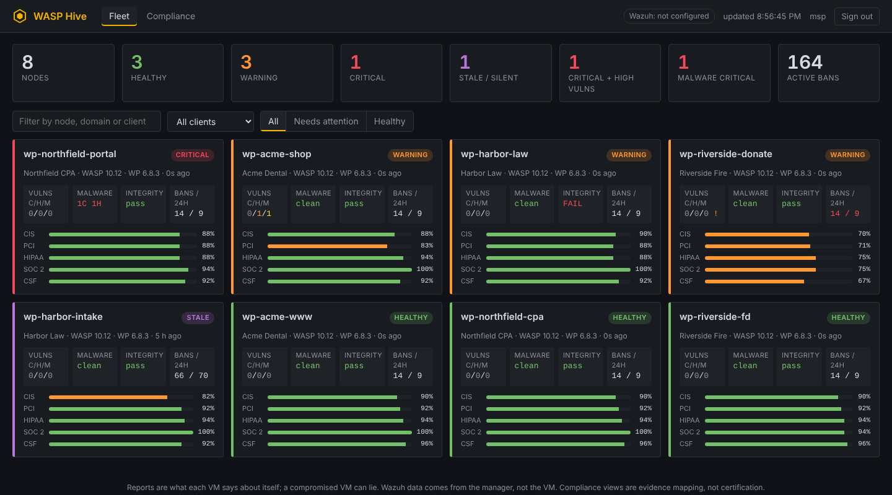
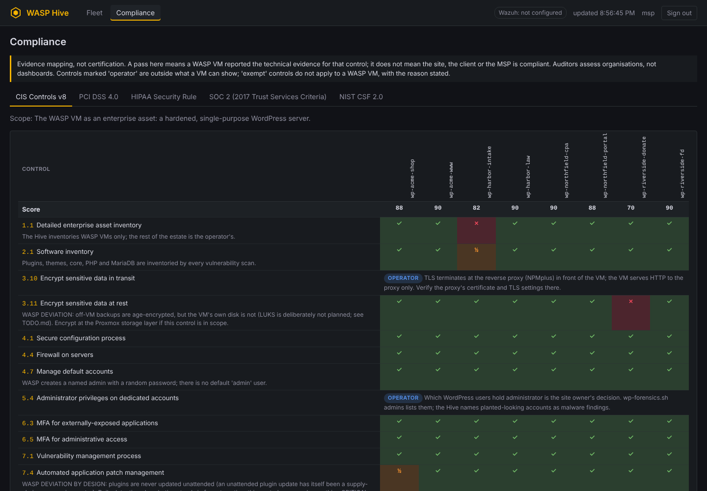

# WASP Hive — the fleet console

WASP Hive is a small, read-only web console for an MSP running many WASP VMs.
One page shows every VM's state: health, known vulnerabilities, malware
findings, file integrity, CrowdSec activity, backups, open egress and which
security controls are on. A second page maps that evidence onto five
compliance frameworks, and states plainly what a WASP VM cannot show and what
does not apply to it. Wazuh can be added as a second source.

It is [Option B in FLEET.md](FLEET.md#option-b--a-central-aggregator-vm-only-if-you-outgrow-a),
built the way that page insists: **it observes and cannot control.**



---

## How it is secured

**Push, not pull.** Each WASP VM sends a report every 15 minutes
(`wasp-hive-report.sh send`, from cron). The Hive never connects to a VM and
holds no credential that could. Its database holds status, not keys. If the
Hive is broken into, the attacker can show wrong numbers; they cannot reach,
read or change anything on the fleet. A dashboard that held SSH keys or API
tokens for every client site would be the most valuable machine you own. This
one is worth very little to an attacker, by design.

**One token per VM, one power.** `hive-admin enroll` creates a random token
for a single VM. It is shown once and stored on the Hive as a SHA-256 hash,
compared in constant time. The only thing it can do is replace that VM's own
report. The Hive takes the node name from the token, not from the report body,
so a VM cannot write another VM's row. A VM also cannot claim evidence that
only the Hive holds (see *Wazuh*). On the VM the token sits in a 0600 file and
is passed to curl in a header file, never on a command line, where `ps` would
show it.

**Pinned key, not a certificate authority.** The Hive makes its own
self-signed key at install. Enrollment pins the SHA-256 of that public key on
each VM (`curl --pinnedpubkey`). A machine in the middle on the VLAN therefore
cannot read a report or a token, and no CA is trusted at all. If the Hive's key
changes, every VM **withholds its report** and logs *"Hive certificate does NOT
match the pinned key"*. That means the Hive was re-keyed, or someone is in the
middle. Do not re-enroll until you know which. The pin is of the key, not the
certificate, so the certificate can be renewed with the same key without
touching the VMs.

**The dashboard is read-only, and the sign-in is hard.**

- **Sign-in:** a password (PBKDF2-SHA256, 600,000 iterations) **and** a TOTP
  code from an authenticator app. A code cannot be used twice. Five failures
  from one address lock it out for 15 minutes. An unknown user name costs the
  same time as a known one, so response timing does not reveal which names
  exist.
- **Session cookie:** `HttpOnly; Secure; SameSite=Strict`, eight hours. It is
  stored on the Hive only as a hash.
- **Headers:** a strict Content-Security-Policy (no inline script, no
  third-party origin, `frame-ancestors 'none'`), `nosniff`, `no-referrer` and
  `no-store`. A POST is refused unless it comes from the dashboard's own
  origin.
- **Rendering:** every value comes from a VM, so all of it is treated as
  untrusted. The page builds its DOM with `textContent`, never `innerHTML`. A
  VM reporting `` as its hostname gets exactly that text
  displayed.
- **No write path:** the web interface can sign in, sign out and read,
  nothing else. Enrolling, revoking and adding users happen in `hive-admin`
  on the Hive's console. A login page that can also add users is a login page
  worth attacking.

**Small.** The server is Python's standard library and nothing else: no pip,
no npm, no CDN. A console that sees the whole fleet's weak spots should not
pull a dependency tree at install time. `install-hive.sh` verifies the release
signature, then checks the `hive/` files against the signed manifest, and
refuses to install on a mismatch.

**Network.**

- **Port:** the service runs unprivileged on 8443, and nftables redirects
  443 to it. A VM with `RESTRICT_EGRESS=1` may reach tcp/443 only.
- **Inbound:** nothing else is accepted, and SSH can be limited to
  `--admin-cidr`.
- **Address limits:** `DASHBOARD_CIDRS` and `INGEST_CIDRS` in `hive.conf`
  narrow who may open the dashboard and who may send reports.
- **TLS:** the handshake runs in each connection's own thread, so one client
  that never finishes it cannot stall the others.

**What it cannot protect against.** A report is what the VM says about
itself, and a fully compromised VM can lie. The Hive makes that harder in two
ways:

- the Wazuh view, which comes from the manager, not the VM;
- staleness: a VM that stops reporting turns purple after 45 minutes.

It cannot make it impossible, and the page footer says so.

---

## Set it up

**1. A VM for the Hive.** Put it on the management VLAN, reachable from the
WASP VMs on 443 and from your admin network. There are two ways to build it.

- **With install.sh (recommended).** Run it on the Proxmox host and choose
  **2) A WASP Hive** at the first question (or preset `WASP_ROLE=hive`). It
  asks the usual VM, disk, network and SSH-key questions, then three more:
  - who may open the dashboard;
  - which networks the WASP VMs are on;
  - the name for the certificate.

  It builds a 1 vCPU / 1 GB / 8 GB Alpine VM with the Hive's firewall in
  place from the first boot. That boot runs `install-hive.sh`, which verifies
  the release signature again on the VM before installing. Watch it with
  `tail -f /var/log/wasp-hive-install.log`. The launcher removes itself once
  it succeeds, and tries again on the next boot if it did not.
- **By hand, on any Alpine VM**, from the unpacked, signed release:

  ```sh
  doas sh hive/install-hive.sh --ssh-cidr 10.20.0.0/24 --dashboard-cidr 10.20.0.0/24 \
       --ingest-cidr 10.40.0.0/16 --name hive.mgmt.lan
  ```

  `--admin-cidr` sets SSH and the dashboard together. With both a dashboard
  and an ingest list, the service port is closed to every other address at
  the firewall, not only in the service.

`doas hive-admin pin` prints the Hive's key pin. Note it down.

**2. A dashboard user.** Each user has a password and an authenticator. The
code is checked before the user is saved, so a mistyped secret cannot lock
anyone out.

```sh
doas hive-admin user-add alice
```

**3. Each WASP VM.** On the Hive:

```sh
doas hive-admin enroll wp-acme-www --client "Acme Dental"
```

It prints one line. Run that line on the VM (or open menu → Security → 24 and
paste it):

```sh
doas wasp-hive-report.sh enroll https://10.20.0.5 wp-acme-www <token> <pin>
```

The first report goes out straight away, and cron sends one every 15 minutes
after that. **At install instead:** the WASP installer asks for this line (or
takes `WASP_HIVE_ENROLL`), and the VM joins as the last step of its install.
The line holds the token, so it is removed from `vars.sh` once used.

### How a VM reaches the Hive

The report is one HTTPS POST from the VM itself: `wasp-hive-report.sh`, run
by cron as root on the host, not inside WordPress. **Squid is not in the
path and has nothing to allow.** Three things decide whether it arrives:

1. **The VM's own firewall (outbound).**
   - With `RESTRICT_EGRESS=0`, nothing is blocked.
   - With `RESTRICT_EGRESS=1`, tcp/443 is already allowed, so a Hive on 443
     needs nothing.
   - A Hive on any other port needs exactly one rule, to that address and
     port: `wasp-egress.sh hive set <address>` adds it (menu → Security →
     25). It refuses Proxmox management and mail ports, which are blocked
     above the egress list on purpose.
2. **The network between them.** The firewall between the WASP VMs' VLANs and
   the Hive must allow the VMs to reach the Hive on tcp/443. In the
   NPMplus + OPNsense layout that is one rule from each site VLAN to the Hive.
   Nothing is needed the other way: the Hive never connects to a VM.
3. **The Hive's own firewall and its `INGEST_CIDRS`.** Both list the VM
   networks given at install.

**Names are resolved once.** `wasp-egress.sh hive set hive.mgmt.lan` resolves
the name, records the address, and the reporter connects to exactly that
address (`curl --resolve`), so the firewall rule and the connection always
agree. A changed DNS answer cannot redirect the report.
`wasp-egress.sh hive refresh` re-resolves deliberately. The reporter also
never uses a proxy (`--noproxy '*'`).

**Proving it.** `wasp-egress.sh hive test` (menu → Security → 26) does three
things:

- it asks the Hive for `/api/v1/ping`;
- it prints the key the Hive presents;
- it says whether that key matches the pin this VM enrolled with.

Compare that key with `hive-admin pin` before enrolling a VM. A mismatch
after enrolling means reports are being withheld, correctly, until you know
why.

**4. Open it.** Go to `https://hive.mgmt.lan/`. The browser warns about the
self-signed certificate. Compare the key with the pin printed in step 1, then
accept it.

### Day to day

| | |
|---|---|
| `hive-admin nodes` | every VM, its client, when it last reported |
| `hive-admin rotate <node>` | new token; the old one stops working. Re-enroll the VM with the new line |
| `hive-admin revoke <node>` | stop accepting that VM; it disappears from the dashboard |
| `hive-admin user-reset <name>` | new password and authenticator; signs the user out everywhere |
| `hive-admin user-disable <name>` | and signed out everywhere |
| `hive-admin audit 50` | the last 50 sign-ins, refusals, enrollments and changes |
| `hive-admin pin` | the key pin again |
| `wasp-hive-report.sh status` *(on a VM)* | where it reports, when it last did, the last failure |
| `wasp-hive-report.sh show` *(on a VM)* | the exact JSON it would send |
| `wasp-hive-report.sh leave` *(on a VM)* | stop reporting and delete the token |

Reports are kept for 90 days (`RETENTION_DAYS`). The service log is
`/var/log/wasp-hive.log`, one line per request and no bodies. Restart with
`doas rc-service wasp-hive restart`.

**Backing up the Hive.** Copy `/etc/wasp-hive/` and
`/var/lib/wasp-hive/hive.db`. If you lose the key, every VM must be
re-enrolled. If you lose the database, every VM must be re-enrolled and every
user re-added. Neither loss exposes anything on the fleet.

---

## What a VM reports

Nothing in the report is measured at send time except health and CrowdSec.
Everything else is read from what the scheduled jobs already recorded, so a
report costs a few file reads and three `podman exec` calls.

| Section | Source on the VM |
|---|---|
| `health` | `validate-wordpress.sh --check` (line and exit code), disk use, uptime |
| `versions` | WordPress, PHP and MariaDB, from the containers |
| `vulns` | the daily scan's saved report (`/var/cache/wp-vulns/last-report.txt`) and its state: when, complete or not, which sources, each finding with severity and CVE |
| `malware` | the last live-site scan (`/var/lib/wp-malware-scan`) |
| `integrity` | `wasp-verify-integrity.sh` (installed tooling vs the signed manifest) and the weekly core/plugin checksum verification |
| `crowdsec` | LAPI reachable, bouncer state, active bans, alerts in 24h, top five scenarios; `appsec`: on or off, listening, failure action, memory, watchdog restarts and requests blocked in 24h |
| `backups` | newest local dump, last off-VM upload, whether off-VM is configured, last error |
| `egress.temporary` | what `wasp-egress` has open temporarily, and when it closes |
| `controls` | MFA, admin IP restriction, login slug, egress proxy, VM egress restriction, profile, release signature, alert mail, heartbeat, vulnerability sources |

`wasp-hive-report.sh show` prints it. The schema is `1`. A field an older VM
does not send makes a compliance control **unknown**, never **fail**.

### States on the fleet page

| State | Means |
|---|---|
| **critical** | validate says CRITICAL, or a CRITICAL malware finding, a CRITICAL known vulnerability, or installed tooling that does not match the signed manifest |
| **warning** | validate says WARN, a HIGH vulnerability or malware finding, an incomplete vulnerability scan, a core/plugin file that fails its checksum, CrowdSec unable to reach its LAPI, or AppSec switched on but not listening (requests passing uninspected) |
| **stale** | no report for 45 minutes (`STALE_MINUTES`). Stale outranks everything: an old report describes a VM that may not exist in that state any more |
| **never** | enrolled, but no report has arrived |

---

## Wazuh (optional)

If you run a Wazuh manager, the Hive can show, beside WASP's own data, what
the manager says about each VM:

- agent status and last keep-alive;
- the most recent file-integrity (syscheck) events;
- configuration-assessment (SCA) results, such as the CIS benchmark policy
  for the OS.

A Wazuh agent counts as a WASP VM when its name matches the node name.

The connector is **read-only**, and it is the Hive's one outbound connection.
Create a Wazuh API user with a read-only role (actions `agent:read`, `syscheck:read`,
`sca:read`), then in `/etc/wasp-hive/hive.conf`:

```
WAZUH_URL=https://wazuh.mgmt.lan:55000
WAZUH_USER=hive-ro
WAZUH_PASSWORD_FILE=/etc/wasp-hive/wazuh.password     # root:hive 0640
WAZUH_CERT_SHA256=<sha256 of the manager's certificate, hex>
WAZUH_POLL_MINUTES=10
```

Get the certificate hash with:

```sh
openssl s_client -connect wazuh.mgmt.lan:55000 </dev/null 2>/dev/null \
  | openssl x509 -outform der | sha256sum      # the hex, without the trailing " -"
```

**Pin it.** The pin is checked *before* the password is sent. Without a pin
the connection is encrypted but not authenticated, and the dashboard marks
it **unpinned** in red.

**Central logging evidence comes from the manager, not the VM.** The CIS
8.9/8.10, PCI 10.5.1 and HIPAA 164.312(b) controls pass only when the
**manager** reports that agent as active within the last three polls. A VM
cannot claim it: the Hive drops any `_hive` key a report carries.

**Status: written against the documented Wazuh 4.x API, not yet tested
against a live manager.** `test/test-hive.py` runs it against a stand-in
manager that answers in the documented shapes, and proves the pin is checked
before the password is sent. That is not a real manager. The endpoints used
are listed below. The dashboard shows the connector's last error verbatim, so
a mismatch with a real manager will be visible rather than silent.

- `POST /security/user/authenticate`
- `GET /agents`
- `GET /syscheck/{agent}`
- `GET /sca/{agent}`

Vulnerability data from Wazuh is not read: its `/vulnerability` endpoint was
removed in 4.8, and WASP's own scan is shown instead.

---

## Compliance



**This is evidence mapping, not certification.** A pass means a WASP VM
reported the technical evidence for that control. It does not mean the site,
the client or the MSP is compliant: auditors assess organisations, not
dashboards. The page says this above every matrix. What the Hive is good for
is the fleet-wide answer to *"which of our sites is missing MFA / a fresh
backup / a complete vulnerability scan right now"*, and a record of it over
time.

The map is `hive/compliance.json`. It has two parts:

- **28 evidence checks**, each a test on one report field (or two, combined);
- **five frameworks**, whose controls point at those checks.

| Framework | Controls | Evidence-backed | Operator | Exempt |
|---|---|---|---|---|
| CIS Controls v8 | 30 | 20 | 8 | 2 |
| PCI DSS 4.0 | 20 | 12 | 6 | 2 |
| HIPAA Security Rule | 15 | 8 | 6 | 1 |
| SOC 2 (2017 TSC) | 13 | 8 | 4 | 1 |
| NIST CSF 2.0 | 16 | 12 | 4 | 0 |

Each control gets one of six statuses:

| Status | Means |
|---|---|
| **pass** | every check for the control passed |
| **partial** | some passed |
| **fail** | none passed |
| **unknown** | the report does not carry the evidence (an older WASP) |
| **operator** | outside what a VM can show: the MSP's process, a contract, or another system. The reason is stated |
| **exempt** | does not apply to a WASP VM. The reason is stated |

**Score** = (pass + ½ partial) ÷ (pass + partial + fail + unknown). Operator
and exempt controls are left out, so the score is never inflated by them.

### WASP-specific exemptions and deviations

These are stated on the page next to the control they affect.

**Exempt: does not apply to a WASP VM.**

- **Physical security** (PCI 9, HIPAA 164.310). A VM. It belongs to the data
  centre hosting the Proxmox node.
- **Stored cardholder data** (PCI 3). WASP's supported PCI scope is a payment
  provider's hosted page or iframe (SAQ A-type). Card data never touches the
  VM. A site that takes card numbers in its own form is not a supported WASP
  configuration, and the PCI mapping says so in its scope line.
- **Signature updates at scan time** (CIS 10.2). WASP's YARA rules change
  only with a signed release, on purpose: a rule set fetched at scan time is
  unsigned code run against every file. ClamAV, if installed, updates its own.
- **Application development** (CIS 16). WASP does not develop the
  application. Third-party code is covered by vulnerability management and
  checksum verification.
- **SOC 2 Confidentiality, Processing Integrity and Privacy categories.**
  Out of scope unless the MSP's report includes them.

**Deviations by design: evidence-backed, with a note.**

- **Unattended patching** (CIS 7.4). WASP never updates plugins unattended,
  because an unattended plugin update has itself been a supply-chain
  compromise vector. Detection plus alerting stands in: the control passes
  when nothing CRITICAL or HIGH is installed.
- **Encryption at rest** (CIS 3.11, HIPAA 164.312(a)(2)(iv), CSF PR.DS-01).
  Off-VM backups are age-encrypted. The VM's own disk is not (see TODO.md).
  Encrypt at the Proxmox storage layer if this is in scope, and document the
  addressable decision for HIPAA.
- **Log retention** (CIS 8.10, PCI 10.5.1). The VM keeps 14 days of web logs.
  90 days or 12 months needs central retention. That is what the Wazuh check
  measures.

- **Application-layer filtering** (CIS 13.10, PCI 6.4.2). It is partial
  unless AppSec is on. Log-based CrowdSec bans *after* an attempt; PCI 6.4.2
  asks for a solution that also *prevents* attacks. `wasp-appsec.sh on` adds
  in-band inspection with the light ruleset (no OWASP CRS). Both controls
  then pass, and an assessor may still expect a full WAF in front of the
  site. Why it is light, and what it costs in memory: README, *Request
  inspection*.

**Operator: the MSP's, stated per control.**

- **TLS in transit.** TLS terminates at the reverse proxy (NPMplus), so it is
  verified there.
- **People and process:** awareness training, the incident-response
  programme, penetration testing, PCI ASV scans, restore drills, risk
  analysis, and the control environment (SOC 2 CC1–CC5, CSF Govern).
- **HIPAA.** A WordPress site must not be a system of record for ePHI. The
  mapping covers a site that may receive ePHI incidentally through a form. A
  **Business Associate Agreement** is needed with the hosting MSP, the mail
  relay and the backup-storage provider before any ePHI reaches the site.

To change the map, edit `hive/compliance.json` and restart the service. It is
covered by the signed manifest like the rest of `hive/`.
`test/test-hive.py` refuses a map that has:

- a control pointing at a check that does not exist;
- an operator or exempt row without a reason;
- a check reading a field no report carries.

---

## Files

| Path | |
|---|---|
| `hive/hive_server.py` | the service (Python standard library) |
| `hive/hive_admin.py` | `hive-admin`: enroll, rotate, revoke, users, audit, pin |
| `hive/compliance.json` | checks and framework mappings |
| `hive/static/` | the dashboard: one HTML page, one script, one stylesheet, no third-party code |
| `hive/install-hive.sh`, `hive/hive.initd` | Alpine installer and OpenRC service |
| `payload/bin/wasp-hive-report.sh` | the VM side, installed on every WASP VM |
| `wasp-egress.sh hive` | the path from a VM to its Hive: one firewall rule when needed, a name pinned to its address |
| `lib/01`, `lib/03`, `lib/06`, `lib/07` | install.sh's "WASP Hive" role |
| `test/test-hive.py` | server: TOTP (RFC 6238 vector), replay, throttle, sessions, CSRF, ingest limits, the compliance engine, a stalled handshake, the Wazuh connector against a stand-in manager |
| `test/test-hive-report.sh` | VM side end to end against a real server: pinning, a re-keyed Hive, token rotation, cross-node writes, token never in argv, the egress path and `--resolve` |
| `test/test-hive-role.sh` | install.sh's Hive role, host side: the ruleset, what is staged, the first-boot launcher's arguments, unsigned releases |

On the Hive: `/opt/wasp-hive/`, `/etc/wasp-hive/{hive.conf,hive.key,hive.crt}`,
`/var/lib/wasp-hive/hive.db`, `/usr/local/bin/hive-admin`.

### Not yet tested live

- **`install-hive.sh` on a real Alpine VM, and install.sh's Hive role on a
  real Proxmox host.** Their parts were each checked: the nftables rulesets
  with `nft -c`, the certificate with its SAN, the signature-key extraction,
  a BusyBox parse, and the staging and first-boot launcher in
  `test/test-hive-role.sh`. The role's prompts in lib/01 are syntax-checked
  only.
- **The Wazuh connector**, against a real manager (see above).

Everything else ran for real: the server, the dashboard in a headless browser,
and the reporter against the server over pinned TLS.
